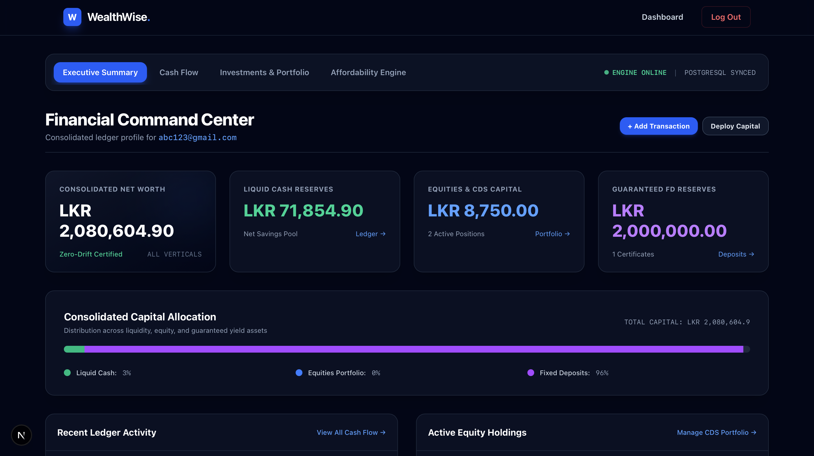
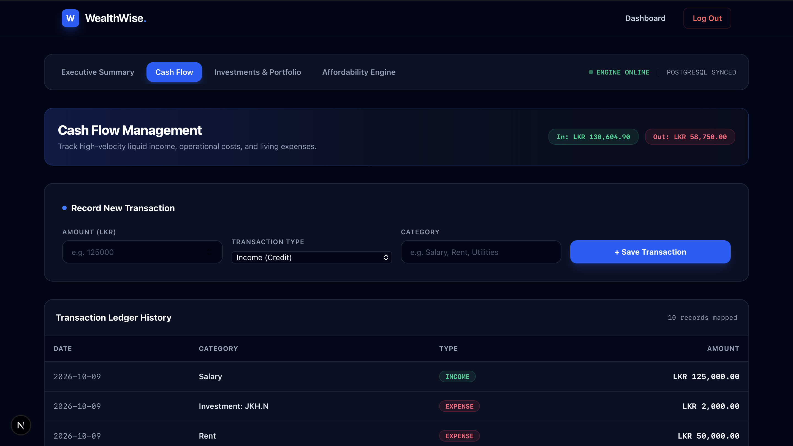
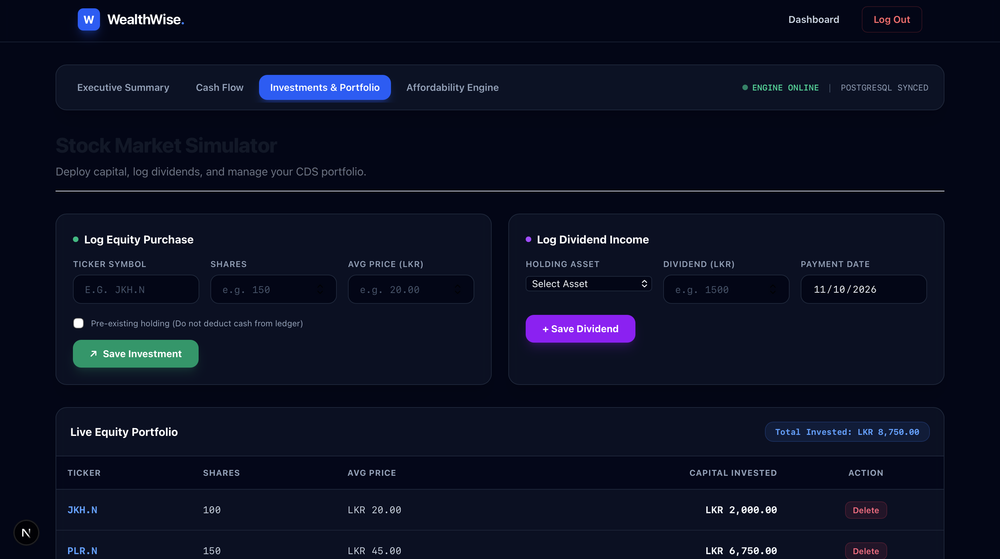

# WealthWise — Enterprise Personal Wealth Management System

-black?style=for-the-badge&logo=next.js)


-green?style=for-the-badge&logo=springsecurity)


WealthWise is an enterprise full-stack wealth engine designed to unify multi-category liquid cash flows, equity holdings (Colombo Stock Exchange), and institutional fixed deposit reserves into an isolated, zero-drift financial ledger.

---

## 📸 System Previews

### Financial Command Center (Executive Summary)


### Cash Flow Management (Liquid Ledger)


### Stock Market Simulator & Fixed Deposit Reserves


---

## 🚀 Key Architectural Features

- **Stateless JWT Security & Identity Enforcement**: Cryptographic token validation via Spring Security filter chains. Controllers enforce ownership server-side using `@AuthenticationPrincipal`, guaranteeing tenant isolation and eliminating Insecure Direct Object Reference (IDOR) vulnerabilities.
- **Automated Dual-Ledger Cascading**:
  - Equity purchases automatically record a corresponding expense debit in the cash flow ledger.
  - Dividend declarations automatically credit an authenticated income transaction to liquid cash reserves with atomic database consistency.
- **Zero-Drift Consolidated Net Worth**: Non-blocking parallel data fetching (`Promise.all`) on Next.js Server Components delivers real-time asset allocation metrics and net worth calculations without client-side drift.
- **Enterprise Dark UI System**: Built with Tailwind CSS, utilizing glassmorphic command ribbons, real-time telemetry pills, and accessible form validations.

---

## 🛠️ Tech Stack & System Architecture

### Frontend
- **Framework**: Next.js 15 (App Router, Server Components)
- **Language**: TypeScript
- **State & Bridge**: React Context API (`AuthContext`), Browser Cookie Bridge
- **Styling**: Tailwind CSS (Enterprise Dark Palette)

### Backend
- **Framework**: Spring Boot 3
- **Security**: Spring Security 6, JJWT (HMAC-SHA256)
- **ORM & Database**: Hibernate / Spring Data JPA, PostgreSQL
- **Validation**: Jakarta Bean Validation (JSR-380)

---

## 💻 Local Setup & Execution Guide

### Prerequisites
- Node.js 18+ & npm
- Java JDK 17 or 21
- PostgreSQL running locally on port `5432` with a database named `wealthwise`

---

### 1. Database Configuration
In `backend/src/main/resources/application.properties`:
```properties
spring.datasource.url=jdbc:postgresql://localhost:5432/wealthwise
spring.datasource.username=postgres
spring.datasource.password=your_password
spring.jpa.hibernate.ddl-auto=update