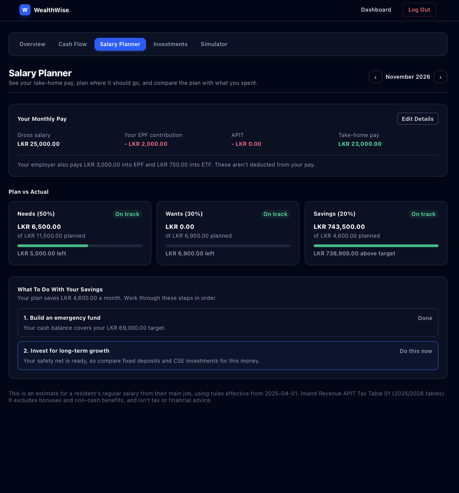
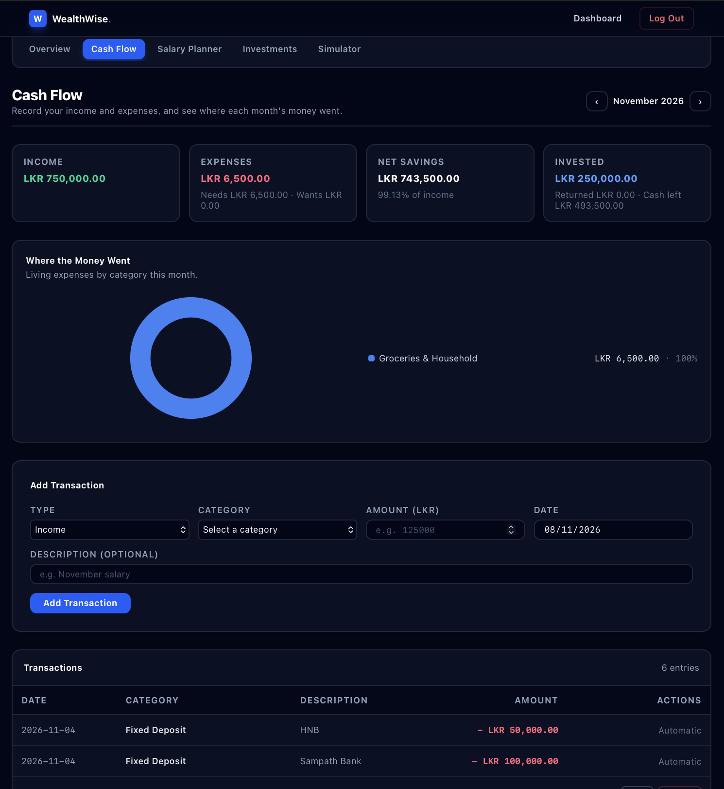
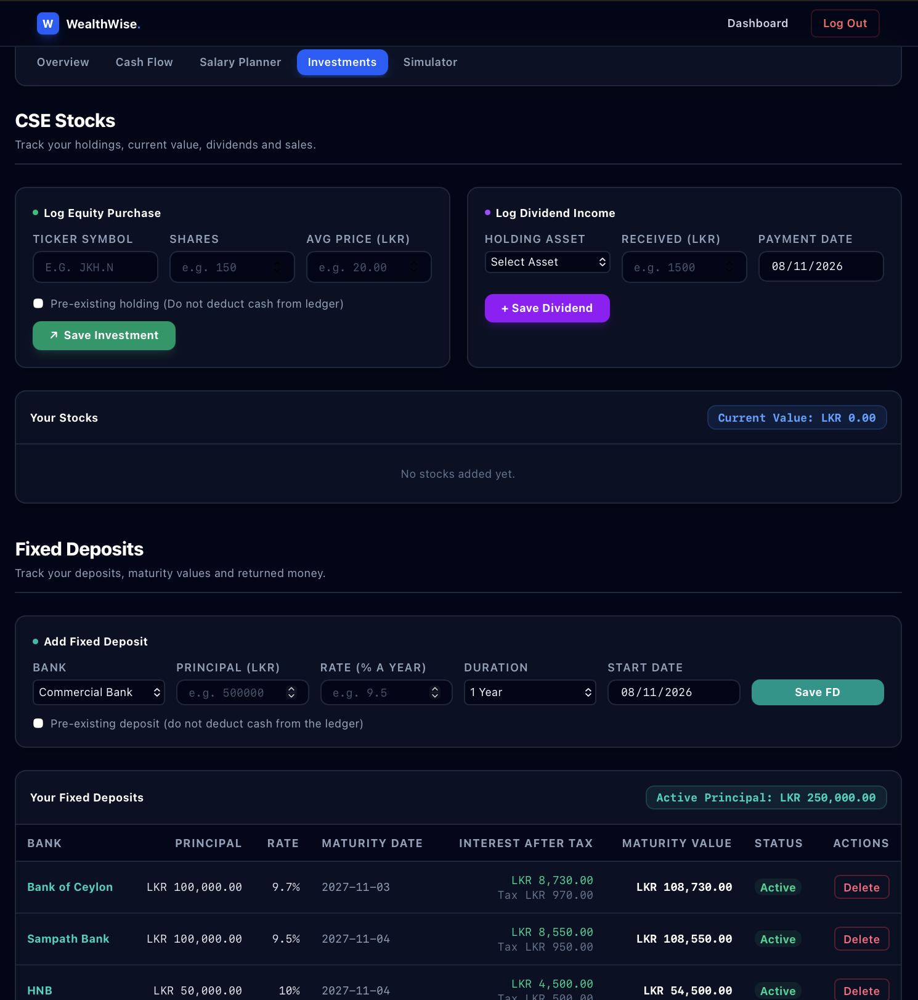
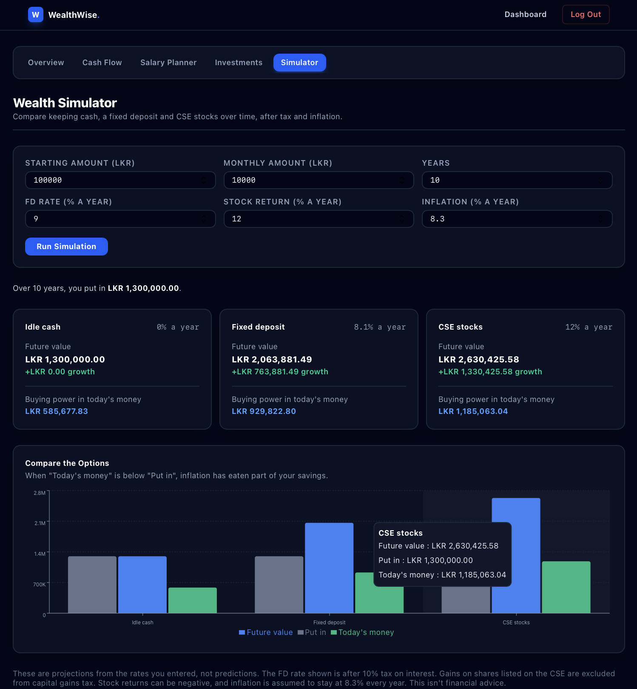
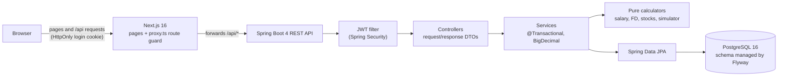

# WealthWise

[](https://github.com/inusha-anujith/wealthwise/actions/workflows/ci.yml)

**Turn a Sri Lankan salary into a clear plan.** WealthWise works out your take-home pay after EPF and APIT, tracks where your money goes each month, and helps you decide what to do with your savings: fixed deposits, CSE stocks or neither.

> WealthWise is a portfolio project. Its figures are estimates for learning and planning, not financial or tax advice.

## Screenshots

| Salary Planner | Cash Flow |
|---|---|
|  |  |

| Investments | Wealth Simulator |
|---|---|
|  |  |

## Features

- **Salary Planner:** enter a gross salary to see your EPF contribution, APIT (from Inland Revenue Tax Table 01) and take-home pay. Split it into needs, wants and savings, compare the plan with what you actually spent, and get savings steps in order: pay off expensive debt, build an emergency fund, then invest.
- **Cash Flow:** record income and expenses in fixed categories, browse month by month, edit or delete manual entries, and see a monthly summary and a spending chart.
- **Fixed Deposits:** see each deposit's maturity date and value after 10% withholding tax, and mark it as matured to return the money to cash.
- **CSE Stocks:** track holdings at prices you enter, with unrealized and realized profit or loss, dividends, and full or partial sales.
- **Wealth Simulator:** compare idle cash, a fixed deposit and CSE stocks over time, in future money and in today's buying power after inflation.
- **Private by design:** every record belongs to one user, and the server checks ownership on every request.

## Architecture



The browser only ever talks to Next.js. Next.js forwards `/api` requests to Spring Boot, so the frontend and backend look like one site and the login cookie works without cross-site configuration.

## Tech stack

| Area | Technology |
|---|---|
| Frontend | Next.js 16 (App Router), React 19, TypeScript, Tailwind CSS 4, Recharts |
| Backend | Spring Boot 4.1, Java 17+, Spring Security, Spring Data JPA, Bean Validation |
| Database | PostgreSQL 16 in Docker, Flyway migrations |
| Auth | JWT in an `HttpOnly`, `SameSite=Lax` cookie |
| Testing and CI | JUnit 5, MockMvc integration tests, GitHub Actions |
| API docs | springdoc OpenAPI (Swagger UI) |

## Key design decisions

- **Money uses `BigDecimal`, never `double`.** Floating-point numbers can't represent values like 0.1 exactly, so they drift in financial sums. Database columns use `NUMERIC(15, 2)`.
- **The user always comes from the verified JWT.** No route accepts a user ID, and every lookup uses queries like `findByIdAndUserId`. Another user's record returns `404`, not `403`, so attackers can't tell whether it exists.
- **DTOs at the API boundary.** Clients can't set fields like `id` or `user` (which prevents mass assignment), and responses never include the user entity or password hash.
- **The login token lives in an `HttpOnly` cookie.** JavaScript can't read it, which protects it from XSS. `SameSite=Lax` blocks cross-site POST, PUT and DELETE requests, which covers CSRF for this API.
- **The ledger stays consistent.** Every automatic entry (a stock purchase, dividend, sale or FD) records which record created it. Deleting or selling updates the ledger in one `@Transactional` method, so cash and net worth can't drift apart.
- **Investments aren't spending.** Buying a stock or FD lowers cash but isn't counted as a living expense, and returned principal isn't counted as income.
- **Tax rules are data, not code.** APIT brackets, EPF/ETF rates and withholding tax rates are stored in dated database rows, so a rule change is a new row, not a code change.
- **Calculations are pure classes.** `SalaryCalculator`, `FixedDepositCalculator`, `StockCalculator` and `SimulatorCalculator` have no Spring or database code, so their unit tests run in milliseconds.
- **The database enforces rules too.** `CHECK` constraints reject invalid amounts and categories even if a bug gets past Java validation.

## Running locally

**You need:** Java 17 or newer, Node.js 22, and Docker Desktop.

1. Clone the repository:
   ```bash
   git clone https://github.com/inusha-anujith/wealthwise.git
   cd wealthwise
   ```
2. Create `backend/.env` from the example and fill in your own values:
   ```bash
   cp backend/.env.example backend/.env
   ```
   Generate a JWT secret with `openssl rand -base64 32`.
3. Start PostgreSQL:
   ```bash
   docker compose --env-file backend/.env up -d
   ```
4. Start the backend. Flyway creates the tables on first run:
   ```bash
   cd backend
   ./mvnw spring-boot:run
   ```
5. In another terminal, start the frontend:
   ```bash
   cd frontend
   npm install
   npm run dev
   ```
6. Open http://localhost:3000 and create an account.

API documentation is at http://localhost:8080/swagger-ui.html. To call protected endpoints there, run `POST /api/auth/login` first.

## Testing

```bash
cd backend
./mvnw test
```

There are 26 tests:

- **Unit tests** for the salary, fixed deposit, stock and simulator calculations, checked against hand-worked examples such as a Rs 250,000 salary giving Rs 222,000 take-home pay.
- **Integration tests** that send real requests through the security filter and database, proving that one user can't read, change or delete another user's transactions, stocks, dividends or fixed deposits. Each test rolls back its data.

GitHub Actions runs these tests against a temporary PostgreSQL, and lints and builds the frontend, on every push and pull request.

## Limitations

- **Tax figures:** APIT uses Inland Revenue Tax Table 01 for a resident's regular salary from their main job. Bonuses, non-cash benefits and other income aren't included.
- **Interest:** fixed deposits assume simple interest paid at maturity.
- **Stock prices:** CSE prices are entered by hand, and broker fees should be included in the sale price.
- **Simulator:** results are projections from the rates you enter, with constant inflation, not predictions.

## Roadmap

- Live CSE prices
- Recurring monthly transactions
- Vehicle and housing affordability calculators
- Treasury bills

## About this project

I built WealthWise to solve a problem I see around me, salaried people in Sri Lanka find it hard to know what they actually take home and what to do with what's left. Actually, I used an AI assistant during development, and I reviewed, tested, and can explain all parts of the system.